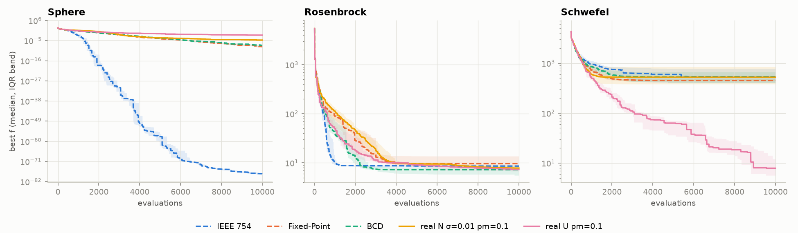
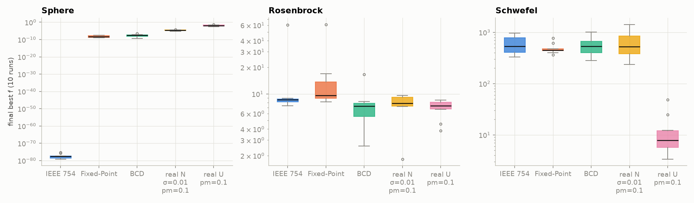
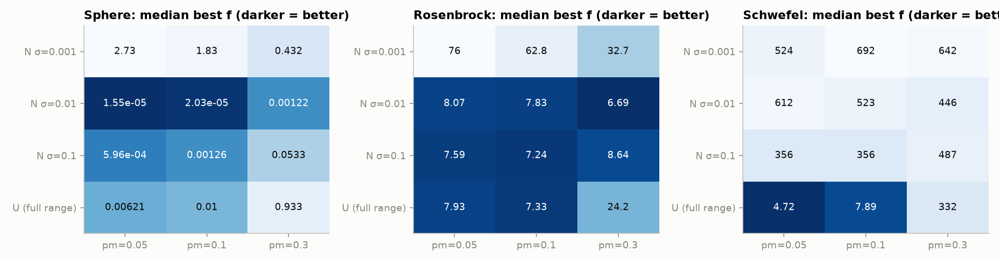

# Genetic Algorithm on Real-Valued Functions
**Binary encodings (IEEE 754, Fixed-Point, BCD) vs. real-valued GA (normal and uniform mutation)**

---

## How to Run

You need Python 3 with `numpy` and `matplotlib`:

```bash
pip install numpy matplotlib
python genetic_algorithm.py
```

The whole experiment takes about 7 s. It prints the tables to the console and saves everything into `results/`: `summary.csv` (statistics for every function and variant), `convergence.png`, `boxplot.png` and `sweep.png`.

## 1. Objective

The goal is to compare GA variants on three real-valued benchmark functions:
- **Sphere** `[-5.12, 5.12]`: unimodal, with the minimum at 0.
- **Rosenbrock** `[-2.048, 2.048]`: a narrow curved valley, with the minimum at (1, …, 1).
- **Schwefel** `[-500, 500]`: multimodal and deceptive, with the minimum at ≈ 420.97, close to the domain edge.

All three functions have a global minimum of f = 0. Schwefel uses the exact constant 418.9828872724338, because the usual rounded 418.9829 would give f ≈ 1.3e-4 at the optimum.

## 2. Algorithm Design

The GA loop is the same for all variants: tournament selection (k = 3), single-point crossover (p = 0.9), mutation, and elitism (the 2 best individuals are kept). Elites keep their fitness and are not re-evaluated.

**Binary GA.** Each dimension is encoded with **32 bits**, so a genome has 10 × 32 = 320 bits. Crossover cuts at any point of the bit string, and each bit flips with probability 1/320. The initial population is drawn uniformly from the domain and then encoded.

Crossover and mutation can produce bit strings that do not decode to a value inside the domain. These are repaired when decoding:
- Values outside the domain are clipped to the nearest bound.
- For IEEE 754, `±inf` is clipped like any other value, and `NaN` is mapped to the upper bound.

As a result, many different bit strings decode to the same boundary point. This affects IEEE 754 the most, because every exponent above the domain's range decodes to a bound.

| Encoding | Layout of the 32 bits |
|---|---|
| IEEE 754 | `float32`: 1 sign bit, 8 exponent bits, 23 mantissa bits |
| Fixed-Point | two's complement: 1 sign bit, an integer part sized to the domain (3 / 2 / 9 bits), and the rest (28 / 29 / 22 bits) for the fractional part |
| BCD | 8 nibbles: a sign nibble (≥ 8 means negative) and 7 decimal digits. The decimal point sits after 1 digit (Sphere, Rosenbrock) or 3 digits (Schwefel). Bit mutation can create the invalid codes `1010`–`1111`. These are read as 9, which slightly favours the digit 9. |

**Real-valued GA.** Single-point crossover *between dimensions*: the two parents swap their coordinate tails. Each coordinate mutates with probability `pm`, using one of two mutations:
- **N**: `x + N(0, σ²)`, where σ is given as a fraction of the domain width, with σ ∈ {0.001, 0.01, 0.1} and pm ∈ {0.05, 0.1, 0.3}.
- **U**: `x` is replaced by a uniformly random value from the whole domain, with pm ∈ {0.05, 0.1, 0.3}.

## 3. Experimental Setup

| Dimension | Fitness Evaluations | Runs | Population | Variants |
|:---:|---:|:---:|:---:|:---:|
| 10D | 10,000 | 10 (seeds 0–9) | 50 | 3 binary + 9 real N + 3 real U |

## 4. Results

The table shows the median best f over 10 runs for all 15 variants (lower is better). Best, worst, mean and sample standard deviation are in [`results/summary.csv`](results/summary.csv).

| Variant | Sphere | Rosenbrock | Schwefel |
|---|---:|---:|---:|
| binary IEEE 754 | **2.2e-78** | 8.60 | 533 |
| binary Fixed-Point | 5.2e-09 | 9.62 | 450 |
| binary BCD | 2.6e-08 | 7.25 | 530 |
| real N σ=0.001, pm=0.05 | 2.73 | 76.0 | 524 |
| real N σ=0.001, pm=0.1 | 1.83 | 62.8 | 692 |
| real N σ=0.001, pm=0.3 | 0.432 | 32.7 | 642 |
| real N σ=0.01, pm=0.05 | 1.6e-05 | 8.07 | 612 |
| real N σ=0.01, pm=0.1 | 2.0e-05 | 7.83 | 523 |
| real N σ=0.01, pm=0.3 | 1.2e-03 | **6.69** | 446 |
| real N σ=0.1, pm=0.05 | 6.0e-04 | 7.59 | 356 |
| real N σ=0.1, pm=0.1 | 1.3e-03 | 7.24 | 356 |
| real N σ=0.1, pm=0.3 | 0.053 | 8.64 | 487 |
| real U pm=0.05 | 6.2e-03 | 7.93 | **4.72** |
| real U pm=0.1 | 1.0e-02 | 7.33 | 7.89 |
| real U pm=0.3 | 0.93 | 24.2 | 332 |

The following plots compare the binary encodings with the reference settings N(σ=0.01, pm=0.1) and U(pm=0.1).




Parameter sweep of the real-valued GA:



**Control experiment: Sphere with the optimum moved to 1.234** (median):

| | IEEE 754 | Fixed-Point | BCD | real N σ=0.01 | real U |
|---|---:|---:|---:|---:|---:|
| Sphere (optimum at 0) | 2.2e-78 | 5.2e-09 | 2.6e-08 | 2.0e-05 | 1.0e-02 |
| shifted Sphere | 1.05 | 1.19 | 0.28 | 2.2e-05 | 1.5e-02 |

## 5. Discussion

**Sphere: the binary "win" comes from where the optimum is.** On the original Sphere all three encodings beat the real-valued GA by several orders of magnitude, and IEEE 754 even reaches 1e-78. The reason is that the optimum is x = 0, which has a special bit pattern:
- In Fixed-Point and BCD, zero is (almost) all zeros. Clearing any 1-bit moves a positive value closer to zero, so every bit can be optimised independently, much like the easy OneMax problem.
- In IEEE 754, lowering the exponent halves the value again and again. float32 goes down to about 1e-45, so x² reaches about 1e-90.

The control experiment confirms this. When the optimum moves to 1.234, all binary encodings drop to f ≈ 0.3–1.2. Neighbouring values now often differ in many bits (Hamming cliffs, carries), and a mutation rate of 1/320 cannot fix several bits at once. The real-valued GA does not care about the shift (2.0e-05 vs 2.2e-05) because normal mutation is translation invariant.

**Choosing σ and pm (normal mutation).** σ sets the step size:
- σ = 0.001·width is too small. The population cannot even travel to the optimum within 10,000 evaluations (Sphere 1.8, Rosenbrock 63).
- σ = 0.1·width is too coarse for fine-tuning (Sphere stalls at about 1e-3).
- σ = 0.01·width is the best compromise.

σ and pm work together. A child moves about pm·D coordinates, each by roughly σ, so the right pm depends on σ and on the landscape:
- **Sphere:** a high pm hurts for every useful σ (σ = 0.01: 2.0e-05 → 1.2e-03; σ = 0.1: 1.3e-03 → 0.053). Near the optimum, changing about 3 of the 10 coordinates at once makes most children worse.
- **Rosenbrock and Schwefel:** with σ = 0.01, pm = 0.3 gives the best result in its row (Rosenbrock 6.69, Schwefel 446), because moving more coordinates means more exploration. With σ = 0.1, the same pm = 0.3 is too destructive on all three functions.
- **σ = 0.001:** a higher pm helps on Sphere and Rosenbrock simply because the population travels faster.

So there is no single best pm: a small σ tolerates, and even needs, a larger pm, while a large σ needs a small pm. On Rosenbrock and Schwefel the gains from pm = 0.3 are smaller than the run-to-run spread (std ≈ 2 and ≈ 300), so they are a trend, not a proven difference.

**Rosenbrock: everyone gets stuck in the valley.** Almost every variant ends at f ≈ 7–9, which means the GA reaches the curved valley but not its far end at (1, …, 1). The differences between these variants are smaller than their run-to-run spread (std ≈ 2). With only 10 runs and no statistical test, none of them can be called better. To move along the valley, neighbouring coordinates have to change together in a coupled way, but crossover between dimensions and per-coordinate mutation change them independently. Only the clearly broken settings fall behind: σ = 0.001 (too slow) and U with pm = 0.3 (too destructive). A few runs (IEEE 754, Fixed-Point, U with pm = 0.05) converge prematurely at f ≈ 60. With a population of only 50, diversity is lost early. Reaching 1.0 in the binary encodings is also hard because of Hamming cliffs. In Fixed-Point, for example, 1.0 = `0 01 000…` while 0.99999 = `0 00 111…`.

**Schwefel: uniform mutation wins clearly.** U with pm = 0.05–0.1 reaches a median of 5–8, while every other variant stays at 350–700. Schwefel has many deep local minima that lie hundreds of units apart, and the global one is close to the domain edge. Normal mutation, even with σ = 100, and low-order bit flips can only fine-tune inside the current basin. Uniform mutation replaces a single coordinate with a random value from the whole range. Because Schwefel is separable, the right basin can be found one coordinate at a time, and elitism keeps every successful jump. With pm = 0.3 too many coordinates are re-randomised at once, which destroys good solutions (332). The binary encodings could jump with a high-order bit, but only a few of the 32 bits per dimension give a large jump, and each flips with probability 1/320, so this happens too rarely.

## 6. Conclusion

- No variant is best on every function. What matters is whether the size of the mutation step fits the landscape.
- The binary encodings look excellent on Sphere only because the optimum is at 0, which has a convenient bit pattern. When the optimum is shifted, they fall behind the real-valued GA.
- Normal mutation with σ ≈ 1% of the domain is a solid default for smooth functions. pm has to be tuned together with σ: a larger σ needs a smaller pm. pm ≈ 1/D is the safest choice on Sphere.
- Uniform mutation with a low pm is the only variant that escapes the local minima of the multimodal Schwefel function.
- None of the variants solves Rosenbrock, because single-point crossover and per-coordinate mutation ignore the coupling between variables.
